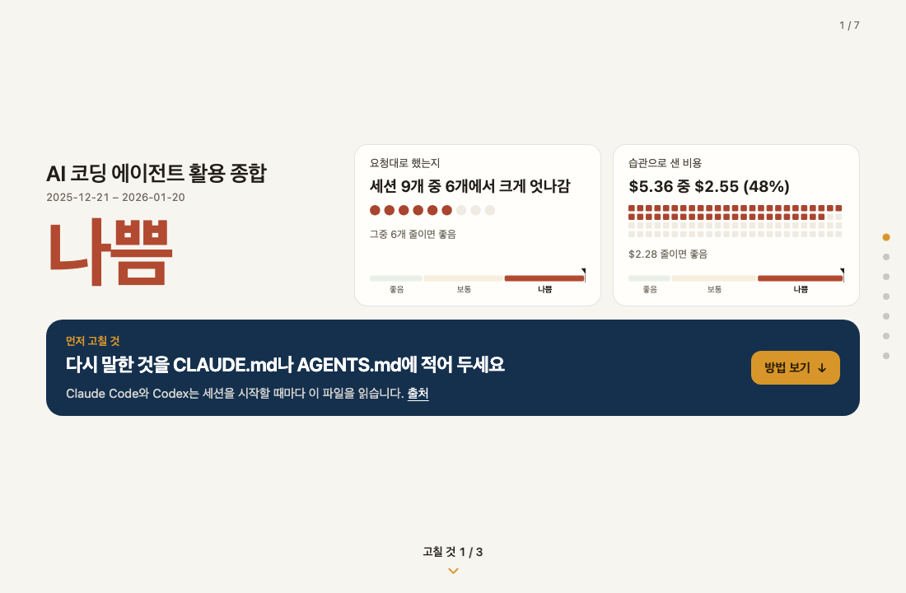

# Leeway

*Leeway: 배가 바람에 밀려 항로에서 옆으로 벗어나는 정도.*

[English](README.md) (영어판이 정본이다. 나머지 문서는 영어로만 제공한다.)

Leeway(`agent-leeway`)는 Claude Code와 Codex로 한 AI 코딩 에이전트 세션을 가끔 점검하는 도구다. macOS, Linux, Windows용 실행 파일 하나로 되어 있다. 내 컴퓨터의 **로컬** 세션 로그를 읽고 두 가지를 알려 준다.

1. **누수 점검(leak check): 돈이나 구독 한도가 어디서 샜나.** 기계적인 비용 누수를 그것을 만든 습관별로 묶고, 습관마다 바꿀 것을 제안한다.
2. **이탈 점검(drift check): 에이전트가 어디서 내 의도를 벗어났고 왜 그랬나.** 사용자가 바로잡아야 했던 순간을 원인별로 나눈다.
   - **에이전트 쪽(agent-side)**: 이미 있던 지시를 어겼거나 에이전트 자체의 오류
   - **프롬프트 쪽(prompt-side)**: 지시가 없거나 모호했다. `AGENTS.md`/`CLAUDE.md`에 넣을 문장을 준다.
   - **판단 불가(undeterminable)**: 기록만으로는 알 수 없다

`agent-leeway report`는 둘을 한 페이지에 담는다. 질문마다 전체 평가를 하나씩 주고, 가장 도움이 될 변경 세 가지(각각 근거 포함), 잘 되고 있는 것, 에이전트가 벗어난 곳과 돈이 샌 곳, 세션별로 찾아보는 부분이 이어진다. HTML 파일(네트워크에서 아무것도 불러오지 않는 파일 하나), 같은 내용을 같은 순서로 담은 Markdown 파일, 짧은 터미널 요약을 만든다. 리포트 언어는 영어나 한국어다(`--lang en|ko`).



*`testdata/`의 합성 테스트 로그로 만든 리포트 첫 화면이다. 실제 사람의 세션은 들어 있지 않다.*

## 하지 않는 것
- **효율 점수나 순위가 아니다.** 점수, 등급, 순위표가 없다. 우리 연구에서 낭비 비율류 지표는 과제 성공 여부를 예측하지 못했다([docs/validation.md](docs/validation.md) §2).
- **상시 감시가 아니다.** 건강검진처럼 가끔 돌리고 이전 점검과 비교한다.
- **코드 품질 판정이 아니다.** 사용자가 알린 버그는 이탈이 아니라 *결함 신고(defect report)*로 따로 센다. 단, 에이전트가 "확인했다"고 한 바로 그 범위의 버그는 거짓 완료(false completion)이므로 이탈로 센다.

## 설치

**요구 사항**
- 따로 설치할 것이 없다. Go, Python, Node 모두 필요 없다.
- 이탈 점검에만 로그인된 공식 **Claude Code** CLI(`claude`)나 **Codex** CLI(`codex`)가 필요하다. 누수 점검에는 둘 다 필요 없다.

**macOS·Linux**
```sh
curl -fsSL https://raw.githubusercontent.com/Mango-Juice/agent-leeway/main/install/install.sh | sh
```
- GitHub Releases에서 내 시스템용 압축 파일을 받아 `checksums.txt`(SHA-256)로 확인한다. 맞지 않으면 아무것도 설치하지 않는다.
- 실행 파일 하나를 `~/.local/bin`에, 라이선스 문서를 `~/.local/share/agent-leeway`에 둔다. sudo가 필요 없고 다른 것은 바꾸지 않는다.
- 선택: `LEEWAY_VERSION=v0.1.0`(버전 지정), `LEEWAY_INSTALL_DIR=<폴더>`(다른 위치).

**Windows (PowerShell)**
```powershell
irm https://raw.githubusercontent.com/Mango-Juice/agent-leeway/main/install/install.ps1 | iex
```
- 내 시스템(x64 또는 ARM64)용 zip을 받아 `checksums.txt`로 확인한다.
- `agent-leeway.exe`를 `%LOCALAPPDATA%\Programs\agent-leeway`에 두고, 그 폴더를 **사용자** Path에만 추가한다. 관리자 권한이 필요 없고 시스템 Path는 바꾸지 않는다.
- 선택: `$env:LEEWAY_VERSION`, `$env:LEEWAY_INSTALL_DIR`.

**직접 설치**
- [Releases 페이지](https://github.com/Mango-Juice/agent-leeway/releases)에서 내 시스템용 압축 파일과 `checksums.txt`를 받아 체크섬을 확인하고, 실행 파일을 PATH에 둔다.
- 소스에서 빌드하려면 [docs/development.md](docs/development.md)를 보라.

**에이전트에 스킬 추가**
```sh
agent-leeway install-skills            # 이 컴퓨터에서 찾은 모든 에이전트
agent-leeway install-skills --claude   # Claude Code만: ~/.claude/skills/agent-leeway/ (또는 CLAUDE_CONFIG_DIR 아래)
agent-leeway install-skills --codex    # Codex만: ~/.agents/skills/agent-leeway/
agent-leeway install-skills --dry-run  # 무엇이 바뀌는지만 보기
```
- 에이전트마다 스킬 사본을 하나씩 둔다. 설치한 뒤에는 어느 에이전트에게든 "누수 점검"이나 "Leeway 리포트"를 부탁하면 된다.
- 스킬에서 실행한 이탈 점검은 **부른 도구의 세션만** 판정한다. Claude Code 사본은 `--tool claude`를, Codex 사본은 `--tool codex`를 넘긴다. 그래서 한 도구에서 시작한 점검이 다른 제공사의 요금제를 쓰는 일이 없다. 두 도구 모두 해 달라고 하면 에이전트가 `--tool all`을 넘긴다. 터미널에서 `--tool` 없이 실행하면 두 도구를 모두 본다.
- 스킬은 에이전트에게 `agent-leeway <명령>`을 실행하라고만 하므로 bash, zsh, PowerShell에서 똑같이 동작한다. 판정을 실행하기 전에는 사용자 승인을 받는다.
- 같은 이름의 스킬이나 사용자가 고친 사본이 이미 있으면 먼저 백업한다.
- Codex 커스텀 프롬프트는 Codex 0.118.0에서 제거되어 프롬프트 파일은 설치하지 않는다.

**업데이트와 제거**
- `agent-leeway self-update --check`는 GitHub에 최신 릴리스 태그를 물어보고 실행할 설치 명령을 보여 준다. **아무것도 내려받지 않고** 스스로를 바꾸지도 않는다.
- 제거 순서:
  1. `agent-leeway uninstall-skills`를 실행한다. agent-leeway가 쓴 스킬 파일만 지우고, 자신이 바꿔 넣었던 `SKILL.md`의 가장 최근 백업을 되돌린다. 사용자가 고친 사본은 그대로 둔다.
  2. 실행 파일을 지운다. macOS/Linux는 `~/.local/bin/agent-leeway`(와 라이선스 폴더 `~/.local/share/agent-leeway`), Windows는 `%LOCALAPPDATA%\Programs\agent-leeway` 폴더다. Windows에서는 그 폴더를 사용자 Path에서도 뺀다.
  3. 필요하면 `agent-leeway privacy`가 보여 주는 캐시·설정 폴더도 지운다.

## Windows
- **지원 범위**
  - Windows 10과 11(Go 도구 체인의 최소 사양), x64와 ARM64
  - 네이티브 Claude Code와 네이티브 Codex
  - 모든 명령. 출력은 색 코드 없는 일반 텍스트이고, 콘솔에서 한국어가 제대로 보인다.
- **서명하지 않은 실행 파일이다.** 릴리스에는 코드 서명이 없다. SmartScreen이 "Windows의 PC 보호" 창을 띄울 수 있고(*추가 정보* → *실행*), Windows 11의 **스마트 앱 컨트롤(Smart App Control)**은 평판이 쌓이기 전까지 서명 없는 프로그램을 막을 수 있다.
  - 설치 스크립트는 SHA-256 체크섬을 대신 확인한다.
  - 직접 받았다면 `Get-FileHash <파일> -Algorithm SHA256` 결과를 릴리스의 `checksums.txt`와 비교한다.
  - 릴리스의 모든 압축 파일에는 빌드 증명(attestation)이 붙어 있다. `gh attestation verify <파일> -R Mango-Juice/agent-leeway`로 확인한다.
- **WSL.** Claude Code나 Codex를 *WSL 안에서* 쓰면 로그는 Linux 홈에 있다. 위의 curl 명령으로 WSL 안에 Linux 빌드를 설치해 실행하라. Windows 빌드는 WSL 안의 로그를 읽지 않는다.
- **Windows CI 러너에서 시험했다.** 테스트 전체와 설치 스크립트를 Windows x64·ARM64 러너(PowerShell 5.1과 7)에서 돌린다. 실제 Windows 컴퓨터에서는 아직 실행해 보지 않았다.

## 동작 방식
- **누수 점검**(`agent-leeway leak`)은 일반 코드다. Codex의 압축 로그(`*.jsonl.zst`)와 `archived_sessions`를 포함한 로컬 로그에서 다음을 찾는다.
  - 긴 공백 뒤 프롬프트 캐시 만료
  - 세션 중 모델·도구 변경 뒤 캐시 재작성
  - 같은 명령 반복과 연속 실패
  - 바뀌지 않은 파일 재읽기
  - 과대 도구 출력

  각 항목을 출처가 붙은 내장 가격표로 API 정가 환산한다(`agent-leeway prices`, `prices --edit`로 설정 폴더에 복사해 고칠 수 있다). 직접 대화와 자동화로 나누고, 직전 같은 길이 기간과 비교한다. 모델을 부르지 않고 아무것도 밖으로 보내지 않는다.
  - Claude Code는 기본적으로 30일이 지난 기록을 지운다(`cleanupPeriodDays`). 기간이나 비교 기간이 가장 오래된 기록보다 앞서면 출력에 그 사실을 적는다.
  - 가격표가 90일보다 오래됐거나 표에 있는 할인 가격이 끝났으면 `leak`과 `drift`가 그 사실을 한 줄로 알린다.
- **직접 대화와 자동화.** 습관은 내가 직접 한 대화를 기준으로 보여 준다. 자동 실행(스크립트, `claude -p`, `codex exec`, 오케스트레이터 작업자)은 따로 세고, `--include-auto`를 주지 않으면 이탈 점검에서 판정하지 않는다.
  - 구분에는 로그에 남은 실행 주체 필드를 쓴다. Claude Code는 `entrypoint`, Codex는 `originator`와 세션 source다. 프롬프트 안의 작업자 문구도 본다. 이 필드들은 제공사가 문서로 밝히지 않은 것이라, 목록을 설정으로 두었다(`settings.json`의 "origin": `worker_markers`, `auto_entrypoints`, `interactive_entrypoints`, `auto_originators`, `interactive_originators`, `auto_sources`). 기본값은 실제 로그에서 본 값이다.
  - 실행 주체가 어느 목록에도 없는 세션은 **불확실(uncertain)**로 둔다. 직접 대화로 세되, `leak`이 그런 세션 수와 사용액을 알려 준다.
- **이탈 점검**(`agent-leeway drift`)은 모델을 판정자로 쓰되 **사용자 자신의 공식 CLI**로 부른다.
  - Claude Code 세션은 `claude -p`로, Codex 세션은 `codex exec`로 보낸다. 각 세션은 그 세션을 만든 제공사에만 간다.
  - 기본 판정 모델은 `claude:opus`와 `codex:gpt-6.2-astra`다. `--model`이나 settings.json으로 바꾼다.
  - 프롬프트와 기록은 명령줄이 아니라 표준 입력으로 넘긴다.
  - 판정자는 고쳐 쓸 수 있는 규칙집([docs/rubric.md](docs/rubric.md))을 따르고, 사건마다 원문 인용을 붙여야 한다. 인용은 코드로 검사해 원문에 없으면 그 사건을 버리고, 세션 판정은 사건 목록으로 코드가 다시 계산한다.
  - 세션 언어는 무엇이든 된다. 필드 이름과 코드는 영어이고 인용은 쓴 그대로 둔다. 요약과 제안 문장은 그 세션에서 사용자가 주로 쓴 언어로 쓴다.
  - 아주 긴 세션(기록이 16만 자를 넘는 세션)은 가운데를 빼고 판정한다. 그런 세션은 하나하나 기록되고, 요약과 리포트에 몇 개였는지 나온다.
  - 첫 호출 전에 판정 CLI의 `--version`과 도움말(Codex는 `codex features list`도)을 실행해, 판정자 잠금에 쓰는 옵션과 스위치가 모두 있는지 확인한다. 하나라도 없으면 그 이름을 알리고 멈춘다. 시험한 버전은 Claude Code 2.1.329와 codex-cli 0.171.0이다.
  - 직접 만든 규칙집 파일로 판정하면 결과, 요약 줄, 리포트에 "custom rubric"이라고 나온다.
- **의미로 묶기(grouping).** 판정이 끝나면 이탈 점검이 **도구마다 한 번 더 호출**해서, 판정된 문제를 주제별로 묶는다. 주제는 내가 두 개 이상의 세션에서 해야 했던 요청을 내 말로 적은 것이다. 리포트에는 예를 들어 "이 말을 세션 3개에서 해야 했다"처럼 나온다.
  - **두 도구 모두 기본으로 켜져 있다.** `--no-grouping`으로 끄고, 도구별로는 `--grouping claude=off`(또는 `codex=off`), 계속 끄려면 settings.json에 `"grouping": {"claude": false}`를 쓴다.
  - 코드는 사람이 직접 한 말이 적어도 두 세션에서 그 요청을 담고 있을 때만 주제를 남긴다. 에이전트가 같은 종류의 실수를 했다는 것만으로는 주제가 되지 않는다.
  - `--group-only`는 아무것도 판정하지 않고, 기간 안에 이미 판정된 세션만 묶는다.
  - 결과는 캐시의 `drift/groups.jsonl`에 저장된다. `report`는 이것을 읽기만 하고 모델을 부르지 않는다.
- **판정 전 확인.** 기간 안의 세션 수, 판정할 세션 수, 묶기 호출, 예상치를 보여 주고 확인을 받는다. 터미널이 아니면 `--yes` 없이는 실행하지 않는다. 세션은 가장 최근 것부터 고르며, `--max-sessions`나 `--budget` 때문에 일부가 빠지면 그 사실과 바꿀 옵션을 한 줄로 알려 준다.
  - 판정 호출은 동시에 최대 3개다(`--concurrency`).
  - 다음 경우 새 호출을 시작하지 않는다: `--budget`을 넘게 될 때, 제공사가 사용 한도 응답을 줄 때, 이웃한 두 호출이 실패했을 때.
  - 호출마다 30분 제한이 있다(`--timeout`). 시간 초과, Ctrl-C, 종료 신호면 판정 프로그램과 그것이 띄운 프로세스를 모두 끝낸다.
  - `--dry-run`은 보낼 세션 목록을 보여 준다. `--write-inputs 폴더`는 세션별 실제 입력과 시스템 프롬프트를 파일로 써서, 동의하기 전에 읽어 볼 수 있게 한다.
  - 결과는 세션별로 저장되어, 같은 명령을 다시 실행하면 남은 세션만 판정한다.
- **이탈 점검이 쓰는 것.** 세션마다 판정 호출 한 번이며, 로그인된 `claude`나 `codex` CLI로 한다. 구독이면 요금제 사용량에서 빠진다. API 키면 정가 기준 세션당 대략 $0.15~$0.35가 든다. 검증 실행에서 측정한 대략의 값으로 Claude Opus $0.24~$0.32, gpt-6.2-astra $0.15~$0.21이다. 같은 세션을 제공사 캐시 수명 안에 다시 판정하면 훨씬 적게 든다. 실행 전에 보여 주는 예상치는 입력에 대해 높게 잡은 값이다. 단가는 제공사 가격 페이지에서 가져왔으며 `agent-leeway prices`로 보고 `prices --edit`로 고칠 수 있다.
- **호출하기 전에** 기간 안의 세션 수와 판정할 세션 수, 목록, 예상치를 보여 주고 묻는다. `--max-sessions`와 `--budget`으로 한 번의 실행을 제한한다. 묶기는 도구마다 호출 한 번이 더 든다.

## 명령
모든 명령은 `-h`로 옵션을 보여 준다.

| 명령 | 하는 일 | 외부 전송 |
|---|---|---|
| `agent-leeway leak [--since 30d] [--tool claude\|codex\|all] [--json] [--no-prev] [--top 5] [--lang en\|ko]` | 누수 점검: 원인·습관별 금액, 직접 대화와 자동화, 직전 기간과 비교 | 없음 |
| `agent-leeway drift [--since 30d] [--tool claude\|codex\|all] [--project 텍스트] [--max-sessions 50] [--budget USD] [--concurrency 3] [--timeout 30m] [--model claude=opus,codex=gpt-6.2-astra] [--rubric 파일] [--settings 파일] [--include-auto] [--no-grouping] [--grouping claude=on\|off,codex=on\|off] [--group-only] [--write-inputs 폴더] [--lang en\|ko] [--dry-run] [--yes]` | 이탈 점검: 선택·예상·확인·판정·묶기·이어하기. `--tool`은 터미널에서 기본이 두 도구 모두다(스킬은 부른 도구를 넘긴다). `--max-sessions`는 기간 안의 가장 최근 N개 세션만 판정(기본 50, 0이면 전부), `--budget`은 API 정가 기준 달러로 된 선택 제한(기본값 없음). `--dry-run`은 예상과 세션 목록만, `--write-inputs`는 실제 판정 입력을 파일로 | 세션 발췌와, 그다음 묶기용으로 그 도구의 판정된 문제를, 그 세션 제공사의 공식 CLI로만 |
| `agent-leeway report [--since 30d] [--run-drift] [--out 폴더] [--quote-chars 160] [--lang en\|ko]`(이탈 옵션도 받음) | 누수 점검과 이미 판정된 이탈을 합친 터미널 요약과 Markdown·HTML 파일. `--tool`은 이탈 부분만 좁히고, 비용 부분은 늘 두 도구를 모두 다룬다 | `--run-drift`일 때만 |
| `agent-leeway compare <이전.json> <이후.json>` | 두 `leak --json` 결과를 습관별·자동화별로 비교 | 없음 |
| `agent-leeway idle [--days 3]`(1~3650) | 캐시가 만료됐을 최근 세션과 이어 쓸 때의 예상 비용 | 없음 |
| `agent-leeway rubric [--copy-to 파일 [--force]] [--rubric 파일]` | 쓰는 규칙집과 설정 S1~S10 보기, 고칠 사본 만들기. `--copy-to`는 이미 있는 파일을 덮어쓰지 않으며, `--force`면 먼저 백업하고 바꾼다 | 없음 |
| `agent-leeway prices [--edit]` | 가격표 보기(백만 토큰당 USD, 출처와 읽은 날짜), 또는 설정 폴더에 `prices.json`으로 복사(그 뒤로는 내장 표 대신 쓰임) | 없음 |
| `agent-leeway privacy` | 이 컴퓨터의 데이터 위치와 외부로 나가는 것 | 없음 |
| `agent-leeway install-skills` / `uninstall-skills [--claude] [--codex] [--dry-run]` | 스킬 추가·제거 | 없음 |
| `agent-leeway self-update --check` | 새 릴리스가 있는지 알리고 설치 명령 표시 | GitHub에 최신 릴리스 태그를 물음 |

공통 옵션(`leak`, `drift`, `report`. `idle`과 `privacy`는 `--claude-dir`, `--codex-dir`만 받는다):
- `--claude-dir`, `--codex-dir`: 다른 폴더의 로그를 읽는다.
- `--no-archived`: Codex `archived_sessions`를 건너뛴다.
- `--refresh`: 캐시를 무시한다.
- `--workers`: 동시에 로그를 읽는 수.
- `--cache`: 다른 캐시 폴더를 쓴다.
- `--no-current-instructions`: 이탈 점검에서 Claude Code 세션에 현재 지시 파일을 넣지 않는다.
- `--lang en|ko`: 요약과 리포트의 언어. 기본값은 settings.json의 `"language"`, 그다음 `LC_ALL`/`LANG`, 그다음 영어다.

## 개인정보: 무엇이 어디로 가나
| 단계 | 읽는 것 | 보내는 것 |
|---|---|---|
| 누수 점검, idle, compare | 로컬 세션 로그: Claude Code 기록 `~/.claude/projects`(또는 `$CLAUDE_CONFIG_DIR/projects`), Codex 세션 `~/.codex/sessions`와 `archived_sessions`(또는 `$CODEX_HOME` 아래), `*.jsonl.zst` 포함 | 없음 |
| 이탈 점검: 판정 | 로컬 로그에서 내 요청, 에이전트 활동 요약(명령·수정 파일·실패·마지막 답), 로그에 남은 지시문. Claude Code 세션은 로그에 지시문이 없으면 현재 `CLAUDE.md`, `CLAUDE.local.md`, `AGENTS.md`도 넣는다(`--no-current-instructions`로 끈다) | 세션 발췌를 **그 세션을 만든 제공사**에 내 CLI 로그인으로 보낸다 |
| 이탈 점검: 묶기(판정 뒤, 기본으로 켜짐, `--no-grouping`으로 끔) | 그 도구의 판정된 문제: 짧은 id, 규칙·원인 코드, 인용된 지시, 판정자가 본 그대로의 내 말 인용(가리지 않음), 판정자의 요약. 에이전트 쪽 발화는 보내지 않는다 | 도구마다 한 번, 같은 제공사의 CLI로, 같은 잠금 아래 |
| 리포트 | 위 결과 | 없음. 캐시와 리포트는 캐시 폴더(`~/.cache/agent-leeway`, Windows는 `%LOCALAPPDATA%\agent-leeway`)에 남는다 |

- **판정자가 할 수 있는 일.** 판정 호출은 매번 새 비공개 폴더에서 돌고, 세션은 표준 입력으로만 넘긴다.
  - Claude CLI로 강제: 내장 도구 없음, 사용자·프로젝트·로컬 설정과 훅 없음, CLAUDE.md·스킬·플러그인·MCP 서버 없음, 슬래시 명령 없음, 권한 요청 거부, 세션 저장 안 함. 결과가 두 턴 이상이거나 권한 거부가 있으면 그 호출은 실패로 처리한다.
  - Codex CLI로 강제: 셸·exec·이미지·앱·플러그인·훅·메모리·하위 에이전트 도구 끔, 웹 검색 끔, 사용자 설정·규칙·프로젝트 설정 안 읽음, 읽기 전용 샌드박스, 승인 없음. 그래도 도구 호출이 보이면 그 실행을 멈추고 기록하지 않는다.
  - 프롬프트로만 요청(강제 아님): 기록을 데이터로 다루고 JSON으로만 답하라.
- 판정 CLI는 사용자 환경을 물려받는다. 설정해 둔 base URL(`ANTHROPIC_BASE_URL`, `OPENAI_BASE_URL`)이나 프록시가 적용되고, CLI 자체의 원격 측정도 함께 간다.
- `self-update --check`는 GitHub에 최신 릴리스 태그를 묻는다. 가격은 로컬 표에서 읽으며 아무것도 받아 오지 않는다.
- 모든 명령은 로그에서 찾은 프로젝트 폴더에서 프로젝트 이름을 얻으려고 `git rev-parse`(읽기 전용)를 실행한다.
- 리포트에는 원문 전체가 아니라 위치와 짧은 발췌(기본 160자, `--quote-chars`)만 나온다. 발췌나 요약을 보여 주기 전에 키와 토큰을 gitleaks 기본 규칙에 바탕을 둔 규칙으로 찾아 `[masked <규칙>]`으로 가린다. 저장된 결과에는 원문이 그대로 남고, 판정과 묶기 호출도 가리지 않은 원문을 본다.
- `report`는 네트워크 요청을 하지 않는다. HTML 파일은 밖에서 아무것도 불러오지 않는다.
- 인증 정보는 읽거나 저장하지 않고, 자체 키로 제공사 API를 부르지 않는다.
- 이탈 점검 전에 내 요금제의 제공사 데이터 정책을 확인하라.
- `agent-leeway privacy`가 내 컴퓨터의 실제 폴더와 외부로 나가는 것의 전체 목록을 보여 준다.

## 설정과 규칙집
**설정 파일**(선택): `~/.config/agent-leeway/settings.json`, Windows는 `%APPDATA%\agent-leeway\settings.json`. 예:
```json
{"judge": {"claude": "claude:opus", "codex": "codex:gpt-6.2-astra"},
 "language": "ko",
 "grouping": {"claude": true, "codex": true},
 "rubric": "/path/to/my-rubric.md",
 "rubric_settings": {"S1": "4"},
 "origin": {"auto_entrypoints": ["sdk-cli"], "interactive_originators": ["codex_cli_rs", "codex-tui"]}}
```

`"origin"` 아래에 적은 목록은 그 목록의 기본값을 대신한다. 적지 않은 목록은 기본값을 그대로 쓴다.

**규칙집**은 일반 Markdown 파일이다: [docs/rubric.md](docs/rubric.md)(v2.1, 영어). 프로그램 안에도 사본이 들어 있다. 바꾸려면 `agent-leeway rubric --copy-to my-rubric.md`로 사본을 만들어 고친 뒤 `--rubric my-rubric.md`로 넘기거나 settings.json의 `"rubric"`에 지정한다.
- **Part A**에 설정 **S1~S10**이 있다. 예:
  - 같은 원인의 작은 이탈이 몇 번이면 큰 이탈로 볼지(기본 3)
  - 확인이 필요한 행동 목록
  - 직접 수정을 이탈로 셀지

  settings.json의 `rubric_settings`로 바꾸거나, 한 번만 바꾸려면 `--settings <파일.json>`을 쓴다.
- **Part B**(`BEGIN MACHINE RUBRIC`~`END MACHINE RUBRIC`)는 판정자가 그대로 보는 부분이다.
- **Part C**는 규칙별 근거 등급과 출처다. "design choice"나 "maintainer default"인 규칙은 문헌 근거가 없으므로 먼저 바꿔 볼 후보다.

## 검증 결과와 한계
자세한 내용은 [docs/validation.md](docs/validation.md)(영어)에 있다.

**공개 데이터**(공개 SpecStory 세션 80개, 발표된 연구의 기준 라벨). 아래 수치는 규칙집 v2 기준이다. 같은 세션에서 v2.1은 P1 재현율 0.67 / 0.88, AUC 0.71 / 0.74였다.
- 사용자 지적이 보이는 불일치 에피소드의 67%(Opus), 87%(astra)를 찾았다. 결함 신고를 포함하면 91%, 95%다.
- 에피소드가 있는 세션과 없다고 추정되는 세션을 AUC 0.72~0.74로 구분했다.
- 원문에 없는 인용은 0.1~0.2%였다.

**재현성(v2.1, 이 Go 프로그램, 실제 CLI).** 모델마다 개발자 세션 15개를 두 번씩 판정했다. 판정이 같았던 세션은 Opus 15개 중 13개(0.87, 95% 구간 [0.62, 0.96]), gpt-6.2-astra 15개 중 15개(1.00, [0.80, 1.00])였다. 사건 위치 Jaccard는 0.84와 0.91이다. 표본이 15개라 Opus 구간이 넓다.

**규칙집 언어.** Opus로 공개 세션 40개를 판정했을 때 규칙집 v2.1의 한국어 번역과 영어 원문의 판정이 0.875 일치했다. 같은 규칙집을 두 번 돌렸을 때의 일치도(0.87)와 같은 수준이다.

**사용자 언어로 쓴 요약.** 판정자에게 요약을 사용자 언어로 쓰라고 바꾼 뒤, 같은 개발자 세션을 다시 판정했다(Opus 15개, astra 13개). 이전 실행과의 판정 일치는 0.80과 0.92, 사건 위치 Jaccard는 0.71과 0.91로, 미리 정한 실행 간 편차 허용 범위 안이었다. 지어낸 인용은 없었고 스키마를 어긴 답도 없었다. 한국어 세션에서는 요약이 모두 한국어로 나왔다. 붙여 넣은 영어 텍스트가 대부분인 세션 일부도 한국어 요약을 받았다. Opus의 두 수치는 조금 내려갔는데, 세션 15개로는 문구 변경 때문인지 아닌지 가릴 수 없다.

**묶기.** 심어 둔 주제와 실제 세션으로 두 차례 확인했다. 첫 번째에는 실제 세션에서 나온 Claude Code 주제 둘 중 하나가 틀렸다. 서로 관계없는 에이전트 실수 넷을 사람이 말한 적 없는 규칙 아래 묶었다. 프롬프트와 코드 검사를 바꾼 뒤 두 번째에는 두 모델 모두 영어와 한국어에서 심어 둔 주제 16개를 모두 찾았고 잘못된 주제는 없었으며, 틀렸던 실제 주제도 사라졌다. 실제 세션 표본은 작다. Claude Code 주제 1개와 Codex 주제 4개이고, 이전에 나온 Codex 주제 하나는 더 이상 나오지 않았다. 묶기는 두 도구 모두 기본으로 켜져 있다(docs/validation.md §1.10).

**알아야 할 한계**
- **사람 라벨로 직접 검증하지 않았다.** 공개 기준 라벨은 모델이 만들고 사람이 감사했다(추출 정밀도 0.93, 원인 정확도 0.72). 개발자 로그 비교에는 에이전트 대리 라벨을 썼다.
- **판정이 모델에 따라 다르다.** 같은 세션에서 두 모델의 판정 가중 κ는 규칙집 v1(22세션)과 v2(개발자 세션 44개) 모두 0.61이었다. 짝지은 사건의 원인 일치는 4분류 0.80, 3분류 0.87이었다(v2.1, 공개 데이터). 리포트는 3분류를 앞에 보이고, 쓴 모델을 항상 표시한다.
- **v2.1에서 공개 원인 라벨과의 4분류 일치는 오히려 떨어졌다**(Opus 0.57 → 0.49, astra 0.46 → 0.44). 3분류로는 올랐다(0.74 / 0.69 → 0.78 / 0.74). "지시 누락·모호"는 여전히 가장 약한 원인이다. 공개 라벨에 대한 재현율이 0.33 / 0.23인데, 에피소드가 6개와 13개뿐이다.
- **Codex 판정자는 사건을 과다하게 판정한다.** 깨끗하다고 추정되는 공개 세션에서 사건을 낸 비율이 v2 55%, v2.1 60%였다(Opus는 둘 다 36%).
- **과거 Claude Code 세션에는 지시 파일이 기록되지 않는다.** 기본값으로 *현재* `CLAUDE.md`를 쓰는데, 당시 내용과 다를 수 있다.
- **개발자 로그 수치는 과소 집계됐다.** 개발 중에는 압축된 Codex 로그를 읽지 않아, 그 수치가 Codex 활동 일부를 빠뜨렸다. 이 도구는 압축 로그를 읽는다.
- **규칙집 v2.1은 사전 등록한 품질 기준을 통과했다**(공개 데이터의 P1, P2, P4, 개발자 세션 모델별 15개의 P3). v2에서 v2.1로 오며 생긴 원인 분류의 변화는 언어가 아니라 문구와 원인 판정 절차에서 왔다(docs/validation.md §1.6~§1.8).
- **Go 프로그램.** 위 재현성 실행에서 실제 판정 호출 60번을 했다. 모든 호출이 잠금 옵션을 받아들였고, 도구 없이 한 턴으로 끝났으며, 스키마 문제 없이 읽혔다. 연구용 구현의 고정 단가에서는 합성 데이터와 개발자 로그에서 그 출력을 그대로 재현했다(캐시된 판정 339개 포함). 기본 단가는 일부러 다르게 두었다. 현재 정가라서 Codex 금액이 몇 배 높게 나온다(docs/development.md).
- **개발자 1명의 로그로 만들었다.** 공개 데이터 결과를 우선했고 외부 검증이 더 필요하다.

## 이용 약관상 주의
- 이탈 점검은 **공식** `claude`·`codex` CLI만, 사용자 본인 로그인으로 실행한다. 구독 토큰을 꺼내거나 재사용하지 않고, 제3자 서비스가 대신 제공사를 부르지 않는다. 세션을 다른 제공사로 보내는 것도 거부한다. 고쳐 쓸 때도 이 방식을 지켜라.
- CLI 사용에는 각 제공사와 맺은 약관이 적용된다.
- 이 도구(Leeway)는 Anthropic, OpenAI와 관계가 없다.

## 라이선스와 출처
- MIT. [LICENSE](LICENSE)를 보라.
- 제3자 코드와 검증에 쓴 공개 데이터: [NOTICE.md](NOTICE.md)
- 참고문헌: [docs/references.md](docs/references.md)
- 빌드·테스트·개발 경과: [docs/development.md](docs/development.md)
