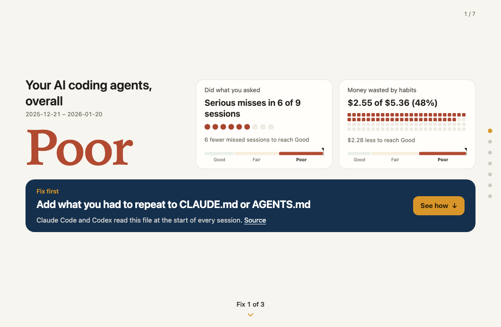

# Leeway

*Leeway: how far a ship is pushed sideways off its course by the wind.*

[한국어](README.ko.md)

Leeway (`agent-leeway`) is an occasional check-up for your AI coding agent sessions in Claude Code and Codex. It is a single executable for macOS, Linux and Windows. It reads your **local** session logs and answers two questions:

1. **Where did my money or plan quota leak?** The *leak check* finds mechanical cost leaks, groups them by the habit that causes them, and suggests a change for each habit.
2. **Where did the agent drift from my intent, and why?** The *drift check* finds the moments where you had to steer the agent back, and splits them by cause:
   - **agent-side**: the agent broke an instruction that was already there, or made its own error
   - **prompt-side**: the instruction was missing or ambiguous; you get a sentence you can add to `AGENTS.md` or `CLAUDE.md`
   - **undeterminable**: the record is not enough to tell

`agent-leeway report` puts both into one page: an overall rating for each question, the three changes that would help most (each with its source), what is going well, where the agent went off and where the money went, and a section to look things up session by session. It writes an HTML file (one self-contained file that loads nothing from the network), a Markdown file with the same content in the same order, and a short terminal summary. The report can be in English or Korean (`--lang en|ko`).



*The first screen of a report made from the synthetic test logs in `testdata/`, not from anyone's real sessions.*

## What it is not
- **Not an efficiency score or a ranking.** It gives no score, grade or leaderboard. In our research, waste-style ratios did not predict whether a task succeeded ([docs/validation.md](docs/validation.md) §2).
- **Not an always-on monitor.** Run it once in a while, like a health check, and compare with your previous check-up.
- **Not a code-quality judge.** Bugs you report are counted separately as *defect reports*, not as drift. The exception is a bug in exactly what the agent said it had verified. That is a false completion, and it counts as drift.

## Install

**Requirements**
- Nothing else to install: no Go, Python or Node.
- For the drift check only, the official **Claude Code** CLI (`claude`) and/or **Codex** CLI (`codex`), installed and logged in. The leak check needs neither.

**macOS and Linux**

```sh
curl -fsSL https://raw.githubusercontent.com/Mango-Juice/agent-leeway/main/install/install.sh | sh
```

- Downloads the archive for your system from GitHub Releases and checks it against `checksums.txt` (SHA-256). On a mismatch it installs nothing.
- Puts the single executable in `~/.local/bin` and its license texts in `~/.local/share/agent-leeway`. It needs no sudo and changes nothing else.
- Optional: `LEEWAY_VERSION=v0.1.0` to install a specific version, `LEEWAY_INSTALL_DIR=<folder>` to install elsewhere.

**Windows (PowerShell)**

```powershell
irm https://raw.githubusercontent.com/Mango-Juice/agent-leeway/main/install/install.ps1 | iex
```

- Downloads the zip for your system (x64 or ARM64) and checks it against `checksums.txt`.
- Puts `agent-leeway.exe` in `%LOCALAPPDATA%\Programs\agent-leeway` and adds that folder to your **user** Path only. It needs no administrator rights and never changes the machine Path.
- Optional: `$env:LEEWAY_VERSION`, `$env:LEEWAY_INSTALL_DIR`.

**Manual install**
- Download the archive for your system and `checksums.txt` from the [Releases page](https://github.com/Mango-Juice/agent-leeway/releases), verify the checksum, and put the executable on your PATH.
- To build from source instead, see [docs/development.md](docs/development.md).

**Add the skill to your agents**

```sh
agent-leeway install-skills            # every agent found on this computer
agent-leeway install-skills --claude   # Claude Code only: ~/.claude/skills/agent-leeway/ (or under CLAUDE_CONFIG_DIR)
agent-leeway install-skills --codex    # Codex only: ~/.agents/skills/agent-leeway/
agent-leeway install-skills --dry-run  # show what would change
```

- Each agent gets its own copy of the skill. Afterwards you can ask either agent for "a leak check" or "a Leeway report".
- From the skill, the drift check judges **only the calling tool's sessions**: the Claude Code copy passes `--tool claude`, the Codex copy `--tool codex`, so a check started in one tool never uses the other provider's plan. Ask for both tools and the agent passes `--tool all`. Run from a terminal without `--tool`, `agent-leeway` covers both tools.
- The skill only tells the agent to run `agent-leeway <command>`, so it works the same in bash, zsh and PowerShell. It asks for your approval before any judged drift run.
- If a skill with the same name already exists, or a copy you edited, it is backed up first.
- Codex custom prompts were removed in Codex 0.118.0, so no prompt file is installed.

**Updates and removal**
- `agent-leeway self-update --check` asks GitHub for the latest release tag and prints the install line to run. It **downloads nothing** and never replaces itself.
- To uninstall:
  1. Run `agent-leeway uninstall-skills`. It removes only the skill files agent-leeway wrote and restores the newest backup of a `SKILL.md` it had replaced. A copy you edited is left in place.
  2. Delete the executable: `~/.local/bin/agent-leeway` (and the license folder `~/.local/share/agent-leeway`) on macOS/Linux, or the folder `%LOCALAPPDATA%\Programs\agent-leeway` on Windows. On Windows, also remove that folder from your user Path.
  3. Optionally delete the cache and settings folders shown by `agent-leeway privacy`.

## Windows
- **Supported:**
  - Windows 10 and Windows 11 (the Go toolchain's minimum), on x64 and ARM64.
  - Native Claude Code and native Codex.
  - All commands. Output is plain text with no color codes, and non-English text displays correctly in the console.
- **Unsigned binary.** Releases are not code-signed. Windows SmartScreen may show "Windows protected your PC" (choose *More info*, then *Run anyway*), and **Smart App Control** on Windows 11 may block an unsigned program until it has built reputation.
  - The install script checks the SHA-256 checksum for you.
  - To check a manual download yourself, run `Get-FileHash <file> -Algorithm SHA256` and compare the result with `checksums.txt` on the release page.
  - Every release archive has a build provenance attestation. Check one with `gh attestation verify <file> -R Mango-Juice/agent-leeway`.
- **WSL.** If you run Claude Code or Codex *inside WSL*, their logs live in the Linux home. Install and run the Linux build inside WSL with the curl line above. The Windows build does not read logs inside WSL.
- **Tested on Windows CI runners.** The test suite and the install script run on Windows x64 and ARM64 runners (PowerShell 5.1 and 7). It has not yet been run on a physical Windows computer.

## How it works
- **Leak check** (`agent-leeway leak`) is plain code. It reads local Claude Code and Codex logs, including Codex's compressed `*.jsonl.zst` files and `archived_sessions`, and finds:
  - prompt-cache expiry after long breaks
  - cache rewrites after mid-session model or tool changes
  - repeated commands and consecutive failures
  - re-reads of unchanged files
  - oversized tool outputs

  Each is priced at API list price from a built-in price table with its sources (`agent-leeway prices`; `prices --edit` copies it to the settings folder for editing). Results are split by your direct conversations versus automations and compared with the previous window of the same length. No model is called and nothing leaves your computer.
  - Claude Code deletes transcripts after 30 days by default (`cleanupPeriodDays`). When a window or its comparison window reaches further back than the oldest transcript, the output says so.
  - When the price table is more than 90 days old, or a promotional price it lists has ended, `leak` and `drift` print one line saying so.
- **Direct conversations versus automation.** Habits are reported for your own conversations; automated runs (scripts, `claude -p`, `codex exec`, orchestrator workers) are counted separately and are not judged by the drift check unless you pass `--include-auto`.
  - The split uses the launcher fields the logs record: Claude Code's `entrypoint`, and Codex's `originator` and session source. It also uses worker phrases in prompts. These fields are not documented by the providers, so the lists are settings (`settings.json` "origin": `worker_markers`, `auto_entrypoints`, `interactive_entrypoints`, `auto_originators`, `interactive_originators`, `auto_sources`), with the values seen in real logs as defaults.
  - A session whose launcher is on neither list is **uncertain**. It is counted as a direct conversation, and `leak` prints how many sessions and how much spend this covers.
- **Drift check** (`agent-leeway drift`) uses a model as the judge, **through your own official CLI**.
  - Claude Code sessions go to `claude -p`, Codex sessions to `codex exec`. Each session goes only to the provider that produced it.
  - Default judges: `claude:opus` and `codex:gpt-6.2-astra`. Change them with `--model` or in settings.json.
  - The prompt and transcript are passed on stdin, never on the command line.
  - The judge follows an editable rubric ([docs/rubric.md](docs/rubric.md)) and must quote the transcript for every event. Quotes are checked in code, and an event whose quote is not in the transcript is dropped. The session verdict is recomputed in code from the events.
  - Sessions in any language can be judged. Field names and codes are English; quotes stay exactly as written; the judge writes its summaries and the suggested sentences in the language you mainly write in within that session.
  - Very long sessions (a transcript over 160,000 characters) are judged with the middle omitted. Each such session is recorded, and the summary and report say how many there were.
  - Before the first call, the drift check runs the judge CLI's `--version` and help (and `codex features list`) and checks that every flag and switch of the judge lock-down exists. If one is missing it stops and names it. Tested versions: Claude Code 2.1.329 and codex-cli 0.171.0.
  - If you judge with your own rubric file, results, the summary line and the report say "custom rubric".
- **Grouping by meaning.** After judging, the drift check makes **one more call per tool** that groups the judged problems into themes. A theme is a request you had to make in two or more sessions, in your own words; the report then says, for example, "you had to say this in 3 sessions".
  - It is **on by default for both tools**. Turn it off with `--no-grouping`, per tool with `--grouping claude=off` (or `codex=off`), or permanently with `"grouping": {"claude": false}` in settings.json.
  - The code keeps a theme only if the person's own words state the request in at least two sessions. A shared kind of agent mistake is not a theme.
  - `--group-only` judges nothing and groups the sessions already judged in the window.
  - Results are stored in `drift/groups.jsonl` in the cache; `report` reads them and never calls a model.
- **Before judging**, the drift check shows how many sessions are in the window, how many it will judge, the grouping calls, and an estimate, then asks for confirmation. Without a terminal it refuses unless you pass `--yes`. Sessions are taken most recent first; when `--max-sessions` or `--budget` cuts the selection, it says so in one line, with the flag that changes it.
  - It runs up to 3 judge calls at once (`--concurrency`).
  - It stops starting new calls when the `--budget` would be exceeded, when a provider reports a usage or rate limit, or after two adjacent failures.
  - Each call has a 30-minute limit (`--timeout`). On timeout, Ctrl-C or termination, the judge and every process it started are ended.
  - `--dry-run` lists the sessions it would send. `--write-inputs DIR` writes the exact input of each session, and the system prompt, so you can read them before agreeing.
  - Results are saved per session, so running the same command again judges only what is left.
- **What a drift check uses.** One judge call per session, through the `claude` or `codex` CLI you are logged in with. On a subscription this counts against your plan's usage. With an API key it costs roughly $0.15 to $0.35 per session at list price (approximate, measured on the validation runs: Claude Opus $0.24–$0.32, gpt-6.2-astra $0.15–$0.21). Judging the same sessions again within the provider's cache lifetime costs much less. The estimate shown before a run is an upper estimate for the input. Prices come from the providers' price pages; `agent-leeway prices` shows them and `prices --edit` updates them.
- **Before any call**, the drift check shows how many sessions are in the window and how many it will judge, lists them, gives an estimate, and asks. `--max-sessions` and `--budget` limit a run. Grouping adds one call per tool.

## Commands

Every command prints its options with `-h`.

| Command | What it does | Sends anything out? |
|---|---|---|
| `agent-leeway leak [--since 30d] [--tool claude\|codex\|all] [--json] [--no-prev] [--top 5] [--lang en\|ko]` | Leak check: amounts by cause and habit, direct vs automation, compared with the previous window | No |
| `agent-leeway drift [--since 30d] [--tool claude\|codex\|all] [--project TEXT] [--max-sessions 50] [--budget USD] [--concurrency 3] [--timeout 30m] [--model claude=opus,codex=gpt-6.2-astra] [--rubric FILE] [--settings FILE] [--include-auto] [--no-grouping] [--grouping claude=on\|off,codex=on\|off] [--group-only] [--write-inputs DIR] [--lang en\|ko] [--dry-run] [--yes]` | Drift check: select, estimate, confirm, judge, group, resume. `--tool` defaults to both tools from a terminal (the skill passes the calling tool). `--max-sessions` judges the N most recent sessions in the window (default 50; 0 = all). `--budget` is an optional limit in API list-price dollars (no default). `--dry-run` only estimates and lists the sessions; `--write-inputs` writes the exact judge inputs | Session excerpts, then that tool's judged problems for grouping, to that session's own provider via its official CLI |
| `agent-leeway report [--since 30d] [--run-drift] [--out DIR] [--quote-chars 160] [--lang en\|ko]` (plus the drift options) | Terminal summary plus Markdown and HTML files with the leak check and the drift results already judged. `--tool` limits only the drift part; the cost part always covers both tools | Only with `--run-drift` |
| `agent-leeway compare <before.json> <after.json>` | Compare two `leak --json` outputs by habit and automation | No |
| `agent-leeway idle [--days 3]` (1 to 3650) | Recent sessions whose prompt cache has probably expired, and what resuming would cost | No |
| `agent-leeway rubric [--copy-to FILE [--force]] [--rubric FILE]` | Show the rubric in use and settings S1–S10, or copy it for editing. `--copy-to` refuses an existing file unless `--force` (which backs it up first) | No |
| `agent-leeway prices [--edit]` | Show the price table (USD per million tokens, with sources and the date read), or copy it to the settings folder as `prices.json`, which then replaces the built-in table | No |
| `agent-leeway privacy` | Where data lives on this computer and what leaves it | No |
| `agent-leeway install-skills` / `uninstall-skills [--claude] [--codex] [--dry-run]` | Add or remove the skill | No |
| `agent-leeway self-update --check` | Say whether a newer release exists and print the install line | Asks GitHub for the latest release tag |

Common options (`leak`, `drift` and `report`; `idle` and `privacy` take only `--claude-dir` and `--codex-dir`):
- `--claude-dir`, `--codex-dir`: read logs from another folder.
- `--no-archived`: skip Codex `archived_sessions`.
- `--refresh`: ignore the cache.
- `--workers`: number of parallel log readers.
- `--cache`: use another cache folder.
- `--no-current-instructions`: for drift, do not add your current instruction files to Claude Code sessions.
- `--lang en|ko`: the language of the summary and report. Default: settings.json `"language"`, then `LC_ALL` / `LANG`, then English.

## Privacy: what goes where
| Step | Reads | Sends |
|---|---|---|
| Leak check, idle, compare | Local session logs: Claude Code transcripts in `~/.claude/projects` (or `$CLAUDE_CONFIG_DIR/projects`); Codex sessions in `~/.codex/sessions` and `archived_sessions` (or under `$CODEX_HOME`), including `*.jsonl.zst` | Nothing |
| Drift check: judging | From the local logs: your requests and a summary of the agent's actions (commands, edited files, failures, final answers), plus instruction files recorded in the log. For Claude Code sessions it also adds your current `CLAUDE.md`, `CLAUDE.local.md` and `AGENTS.md` files when the log has none (`--no-current-instructions` turns this off) | The session excerpt goes to the **same provider that produced the session**, through your own CLI login |
| Drift check: grouping (after judging; on by default, `--no-grouping` turns it off) | That tool's judged problems: short ids, rule and cause codes, the cited instruction and your own quoted words exactly as the judge saw them (not masked), and the judge's summaries. The agent's own turns are not sent | One call per tool, to the same provider's CLI, under the same lock-down |
| Reports | Results of the above | Nothing. The cache and reports stay in the cache folder (`~/.cache/agent-leeway`; on Windows `%LOCALAPPDATA%\agent-leeway`) |

- **What the judge may do.** Each judge call runs in a fresh private folder, with the session on stdin only.
  - Enforced through the Claude CLI: no built-in tools, no user, project or local settings or hooks, no CLAUDE.md, skills, plugins or MCP servers, no slash commands, permission requests denied, session not saved. A result with more than one turn or any permission denial fails the call.
  - Enforced through the Codex CLI: shell, exec, image, app, plugin, hook, memory and sub-agent tools switched off, web search disabled, user config, rules and project config not loaded, read-only sandbox, no approvals. A run that still shows a tool call is stopped and not recorded.
  - Only requested by the prompt, not enforced: treat the transcript as data, and answer with JSON only.
- The judge CLIs inherit your environment, so a base URL (`ANTHROPIC_BASE_URL`, `OPENAI_BASE_URL`) or proxy you configured applies to them, together with the CLIs' own telemetry.
- `self-update --check` asks GitHub for the latest release tag. Prices come from a local table; nothing is fetched.
- Every command runs `git rev-parse` (read-only) in project folders found in the logs, to name projects.
- Reports show locations and short excerpts (160 characters by default, `--quote-chars`), not full transcripts. Before an excerpt or summary is shown, keys and tokens are masked as `[masked <rule>]`, using rules based on the gitleaks default set. The stored results keep the original text, and the judge and grouping calls see it unmasked.
- `report` makes no network request: the HTML file loads nothing from outside.
- The tool never reads or stores credentials and never calls a provider API with its own key.
- Review your provider's data policy for your plan before running the drift check.
- `agent-leeway privacy` prints the exact folders on your computer and the full list of what goes out.

## Settings and the rubric

**Settings file** (optional): `~/.config/agent-leeway/settings.json`, or `%APPDATA%\agent-leeway\settings.json` on Windows. Example:

```json
{"judge": {"claude": "claude:opus", "codex": "codex:gpt-6.2-astra"},
 "language": "ko",
 "grouping": {"claude": true, "codex": true},
 "rubric": "/path/to/my-rubric.md",
 "rubric_settings": {"S1": "4"},
 "origin": {"auto_entrypoints": ["sdk-cli"], "interactive_originators": ["codex_cli_rs", "codex-tui"]}}
```

Lists given under `"origin"` replace that list's defaults; lists you leave out keep them.

**The rubric** is a plain Markdown file, [docs/rubric.md](docs/rubric.md) (v2.1). The program carries a copy. To change it, run `agent-leeway rubric --copy-to my-rubric.md`, edit the copy, then pass `--rubric my-rubric.md` or set `"rubric"` in settings.json.
- **Part A** lists settings **S1–S10**. Examples:
  - how many repeated minor drifts count as one major drift (default 3)
  - which actions need your confirmation
  - whether hand edits count as drift

  Override them with `rubric_settings` in settings.json, or `--settings <file.json>` for one run.
- **Part B**, between `BEGIN MACHINE RUBRIC` and `END MACHINE RUBRIC`, is exactly what the judge sees.
- **Part C** gives the evidence grade and sources for each rule. Rules marked "design choice" or "maintainer default" have no literature behind them, so they are the first candidates to change.

## Validation, and its limits
Details are in [docs/validation.md](docs/validation.md).

**On public data:** 80 public SpecStory sessions, judged against reference labels from a published study (rubric v2; v2.1 gave P1 recall 0.67 / 0.88 and AUC 0.71 / 0.74 on the same sessions).
- The drift check found 67% (Opus) and 87% (astra) of the user-visible misalignment episodes, or 91% and 95% when defect reports are included.
- It separated sessions with episodes from presumed-clean ones with AUC 0.72–0.74.
- 0.1–0.2% of quotes were not found in the transcript.

**Reproducibility (rubric v2.1, this Go program, real CLIs):** 15 developer sessions per model, each judged twice. The verdict was the same in 13 of 15 sessions for Opus (0.87, 95% interval [0.62, 0.96]) and 15 of 15 for gpt-6.2-astra (1.00, [0.80, 1.00]). Event-location Jaccard was 0.84 and 0.91. With n = 15 the Opus interval is wide.

**Rubric language:** a Korean translation of v2.1 and the English text gave the same verdict in 0.875 of 40 public sessions with Opus, as often as one run of the same rubric agrees with another (0.87).

**Summaries in your language:** after the judge was asked to write its summaries in the user's language, the same developer sessions were judged again (15 with Opus, 13 with astra). Verdict agreement with the earlier run was 0.80 and 0.92, and event-location Jaccard 0.71 and 0.91, within the pre-set tolerance of run-to-run noise; no quote was invented and no answer broke the schema. In Korean sessions every summary came out in Korean; some sessions made up mostly of pasted English text got Korean summaries too. Both Opus figures went down a little, which 15 sessions cannot rule in or out as an effect of the wording.

**Grouping:** checked on planted themes and on real sessions, in two rounds. In the first round one of the two Claude Code themes on real sessions was wrong (four unrelated agent mistakes joined under a rule the person never stated). After the prompt and a code check were changed, the second round found 16 of 16 planted themes with no false theme for both models in English and Korean, and the wrong real theme was gone. The real-session sample is small: one Claude Code theme and four Codex themes (one earlier Codex theme was no longer proposed). Grouping is on by default for both tools (docs/validation.md §1.10).

**Limits you should know**
- **No direct validation against human labels.** The public reference labels were produced by a model and audited by humans (extraction precision 0.93, cause accuracy 0.72). The developer-log comparison used agent proxy labels.
- **Verdicts depend on the model.** Two models judging the same sessions agreed with weighted κ 0.61, both in rubric v1 (22 sessions) and in rubric v2 (44 developer sessions). On matched events the cause agreed in 0.80 of pairs on four causes and 0.87 on three groups (v2.1, public data). Reports lead with the three groups and always name the model used.
- **Agreement with the public cause labels fell under v2.1 on the four-cause scale** (Opus 0.57 → 0.49, astra 0.46 → 0.44). On three groups it rose (0.74 / 0.69 → 0.78 / 0.74). "Missing or ambiguous instruction" remains the weakest cause: recall of the public label is 0.33 / 0.23, on only 6 and 13 episodes.
- **The Codex judge over-calls.** It found events in 55% of presumed-clean public sessions with v2, and in 60% with v2.1, against 36% for Opus with both.
- **Past Claude Code sessions do not record instruction files.** By default the drift check uses your *current* `CLAUDE.md` files, which may differ from what applied at the time.
- **Developer-log figures are under-counted.** During development the compressed Codex logs were not read, so those figures miss part of the Codex activity. The tool reads them.
- **Rubric v2.1 passes the pre-registered quality criteria** (P1, P2 and P4 on public data; P3 on 15 developer sessions per model). The shift in cause attribution from v2 to v2.1 comes from the wording and cause procedure, not the language (docs/validation.md §1.6–§1.8).
- **The Go program.** Its reproducibility run above made 60 real judge calls. Every call accepted the lock-down flags, stayed one turn with no tool use, and parsed without schema problems. Under the research tool's frozen prices it reproduces that tool's outputs exactly on synthetic fixtures and on the developer's logs, including all 339 cached judgments. Its default prices differ on purpose: they are current list prices, which make Codex amounts several times higher (docs/development.md).
- **Built on one developer's logs.** Public-data results take priority, and more outside validation is needed.

## Terms of use
- The drift check runs only through the **official** `claude` and `codex` CLIs, under your own login. It does not extract or reuse subscription tokens, and no third-party service calls a provider on your behalf. It refuses to send a session to a different provider. Keep it that way if you modify it.
- Your use of those CLIs is governed by your agreement with each provider.
- Leeway is not affiliated with Anthropic or OpenAI.

## License and attribution
- MIT. See [LICENSE](LICENSE).
- Third-party code and the public datasets used for validation: [NOTICE.md](NOTICE.md).
- References: [docs/references.md](docs/references.md).
- Building, testing and how the project got here: [docs/development.md](docs/development.md).
